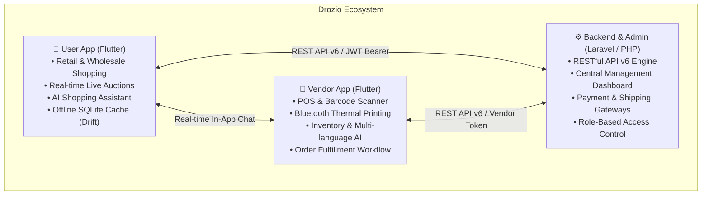

# Drozio — Enterprise Multi-Vendor E-Commerce Platform

<p align="center">
  <b>A comprehensive, high-performance, and scalable multi-vendor e-commerce platform.</b><br/>
  Featuring a Flutter Consumer App, Flutter Vendor Management App with POS, and a robust Laravel Admin & Web Management Portal.
</p>

<p align="center">
  <a href="https://flutter.dev"></a>
  <a href="https://dart.dev"></a>
  <a href="https://laravel.com"></a>
  <a href="https://php.net"></a>
  
  
</p>

---

## 📑 Table of Contents
1. [Ecosystem Overview](#-ecosystem-overview)
2. [Architecture & System Design](#-architecture--system-design)
3. [Repository Structure](#-repository-structure)
4. [Applications Breakdown](#-applications-breakdown)
   - [User Application](#1-user-app-user-app)
   - [Vendor Application](#2-vendor-app-vendor-app)
   - [Admin & Web Backend](#3-admin-and-web-portal-admin-and-web)
5. [Prerequisites & Requirements](#-prerequisites--requirements)
6. [Getting Started & Installation](#-getting-started--installation)
   - [Backend Setup](#backend-setup-admin-and-web)
   - [User App Setup](#user-app-setup)
   - [Vendor App Setup](#vendor-app-setup)
7. [Code Quality & Static Analysis](#-code-quality--static-analysis)
8. [Git & Branching Workflow](#-git--branching-workflow)
9. [Contributing Guidelines](#-contributing-guidelines)
10. [Security & Support](#-security--support)

---

## 🌐 Ecosystem Overview

Drozio connects customers, merchants, delivery personnel, and administrators into an integrated, real-time marketplace ecosystem:



---

## 🏛 Architecture & System Design

Both mobile applications are engineered following **Clean Architecture** principles structured by **Feature-First Domain-Driven Design (DDD)**:

```
feature_folder/
├── controllers/          # State holders extending ChangeNotifier / Provider
├── domain/
│   ├── models/           # Typed immutable entity models & DTOs
│   ├── repositories/     # Abstract repository contracts
│   └── services/         # Abstract & concrete domain business services
├── screens/              # Top-level route pages
└── widgets/              # Reusable UI presentation components
```

- **Separation of Concerns:** Business logic is decoupled from UI presentation.
- **Dependency Injection:** Centralized using `GetIt` (`sl` service locator).
- **Network Layer:** Robust `Dio` client with centralized interceptors, automatic bearer token injection, and structured error handling.
- **Offline First (User App):** Persistent local relational database powered by **Drift (SQLite)**.

---

## 📂 Repository Structure

```
Drozio/
├── .github/
│   ├── workflows/        # GitHub Actions CI/CD pipelines
│   └── ISSUE_TEMPLATE/   # Standardized bug & feature request templates
├── Admin and web/        # Laravel Backend API v6 & Web Control Panel
│   ├── app/              # Laravel Application Models, Services, Controllers
│   ├── config/           # Environment & service configurations
│   ├── database/         # Migrations, seeders, and factory schemas
│   ├── routes/           # Web and API v6 REST endpoint definitions
│   └── resources/        # Blade templates, SCSS, and frontend assets
├── User app/             # Consumer Flutter Application
│   ├── android/          # Android Native wrapper
│   ├── ios/              # iOS Native wrapper
│   ├── assets/           # Localized strings, fonts, SVG/PNG assets
│   ├── lib/              # Feature-driven Dart source code
│   └── pubspec.yaml      # Dependencies & asset declarations
├── Vendor app/           # Merchant & POS Flutter Application
│   ├── android/          # Android Native wrapper
│   ├── ios/              # iOS Native wrapper
│   ├── assets/           # Assets, icons, thermal print templates
│   ├── lib/              # Feature-driven Dart source code
│   └── pubspec.yaml      # Dependencies & asset declarations
├── CONTRIBUTING.md       # Contribution guide & code style standards
├── CHANGELOG.md          # Version release history
└── README.md             # Project documentation entry point
```

---

## 📱 Applications Breakdown

### 1. User App (`User app/`)
- **Navigation:** Modern declarative routing via `GoRouter` with deep linking support.
- **Commerce Capabilities:**
  - Standard B2C retail checkout with multi-currency and multi-language support.
  - B2B Wholesale tiered quantity pricing.
  - Real-time **Live Auction** bidding and auction creator tools.
  - Multi-gateway payment (Stripe, PayPal, Razorpay, Cash on Delivery, Digital Wallet, Offline Payment).
- **Smart Features:** AI Shopping Assistant powered by Gemini API, interactive product zoom, delivery tracking, and push notifications.
- **Offline Storage:** Drift SQLite database for caching products, cart state, and user preferences.

### 2. Vendor App (`Vendor app/`)
- **Point of Sale (POS):**
  - Integrated POS interface with customer selection, custom discounts, and tax computation.
  - ESC/POS thermal printing over Bluetooth (`print_bluetooth_thermal`).
  - Barcode and QR code scanning for fast inventory lookup.
- **Store & Product Management:**
  - Multi-variation physical and digital product creation.
  - AI-assisted product titles, descriptions, and SEO generation.
  - Clearance sales, coupon generation, and withdrawal management.
- **Order Modification:** Edit live orders, exchange items, update delivery assignments, and generate digital invoices.

### 3. Admin and Web Portal (`Admin and web/`)
- **Framework:** Laravel 11/12 on PHP 8.2+.
- **Role-based Access Control (RBAC):** Super Admin, Sub-admins, Vendors, Deliverymen, and Customer portals.
- **Comprehensive Analytics:** Revenue statistics, order summaries, top-selling items, and transaction logs.
- **RESTful API v6:** Comprehensive secure endpoints powering both mobile apps.

---

## ⚙️ Prerequisites & Requirements

| Component | Minimum Version | Recommended Version |
|:---|:---|:---|
| **Flutter SDK** | `>= 3.24.0` | `3.27.x` or `3.47.x` |
| **Dart SDK** | `>= 3.5.0` | `3.6.x` / `3.13.x` |
| **Java / JDK** | `17` | `17 LTS` |
| **Android SDK** | `API 21` (minSdk) | `API 34` / `36` (targetSdk) |
| **Xcode (iOS)** | `15.0+` | `16.x` |
| **PHP** | `>= 8.2.0` | `8.2` or `8.3` |
| **Composer** | `>= 2.5` | Latest |
| **MySQL / MariaDB** | `>= 8.0` / `>= 10.4` | `MySQL 8.0+` |

---

## 🚀 Getting Started & Installation

### Backend Setup (`Admin and web/`)

1. **Navigate to the directory:**
   ```bash
   cd "Admin and web"
   ```

2. **Install PHP dependencies:**
   ```bash
   composer install --optimize-autoloader --no-dev
   ```

3. **Configure Environment:**
   ```bash
   cp .env.example .env
   php artisan key:generate
   ```
   *Edit `.env` to configure `DB_DATABASE`, `DB_USERNAME`, `DB_PASSWORD`, and mail/gateway credentials.*

4. **Run database migrations and seeders:**
   ```bash
   php artisan migrate --seed
   ```

5. **Symlink storage and optimize:**
   ```bash
   php artisan storage:link
   php artisan config:cache
   php artisan route:cache
   php artisan view:cache
   ```

6. **Serve locally:**
   ```bash
   php artisan serve
   ```

---

### User App Setup

1. **Navigate to the directory:**
   ```bash
   cd "User app"
   ```

2. **Configure API Endpoints:**
   Open `lib/utill/app_constants.dart` and update `baseUrl`:
   ```dart
   static const String baseUrl = 'https://your-domain.com';
   ```

3. **Install Flutter packages:**
   ```bash
   flutter pub get
   ```

4. **Run Code Generation (if modifying Drift database or models):**
   ```bash
   dart run build_runner build --delete-conflicting-outputs
   ```

5. **Run the Application:**
   ```bash
   flutter run
   ```

---

### Vendor App Setup

1. **Navigate to the directory:**
   ```bash
   cd "Vendor app"
   ```

2. **Configure API Endpoints:**
   Open `lib/utill/app_constants.dart` and update `baseUrl`:
   ```dart
   static const String baseUrl = 'https://your-domain.com';
   ```

3. **Install Flutter packages:**
   ```bash
   flutter pub get
   ```

4. **Run the Application:**
   ```bash
   flutter run
   ```

---

## 🧪 Code Quality & Static Analysis

Both applications follow strict coding standards and pass Dart static analysis with **zero diagnostics (0 errors, 0 warnings, 0 infos)**.

Run analysis locally at any time:

```bash
# Verify User App
dart analyze "User app"

# Verify Vendor App
dart analyze "Vendor app"
```

Automated verification is configured via GitHub Actions in [`.github/workflows/ci.yml`](.github/workflows/ci.yml) to ensure every Pull Request maintains this standard.

---

## 🌿 Git & Branching Workflow

We adhere to a standard Gitflow branching convention:

- `main` — Production-ready code. Protected branch.
- `develop` — Active development and integration branch.
- `feature/<name>` — New capabilities and screens (branch off `develop`).
- `fix/<name>` — Bug fixes and optimizations (branch off `develop`).
- `hotfix/<name>` — Urgent production patches (branch off `main`).

---

## 🤝 Contributing Guidelines

We welcome contributions! Please review our [CONTRIBUTING.md](CONTRIBUTING.md) for pull request protocols, code formatting rules, and commit message conventions.

---

## 🔒 Security & Support

If you discover any security vulnerabilities or issues, please review our [SECURITY.md](SECURITY.md) for disclosure instructions.

For questions, documentation, or technical support, please contact the Drozio team via GitHub Issues.
