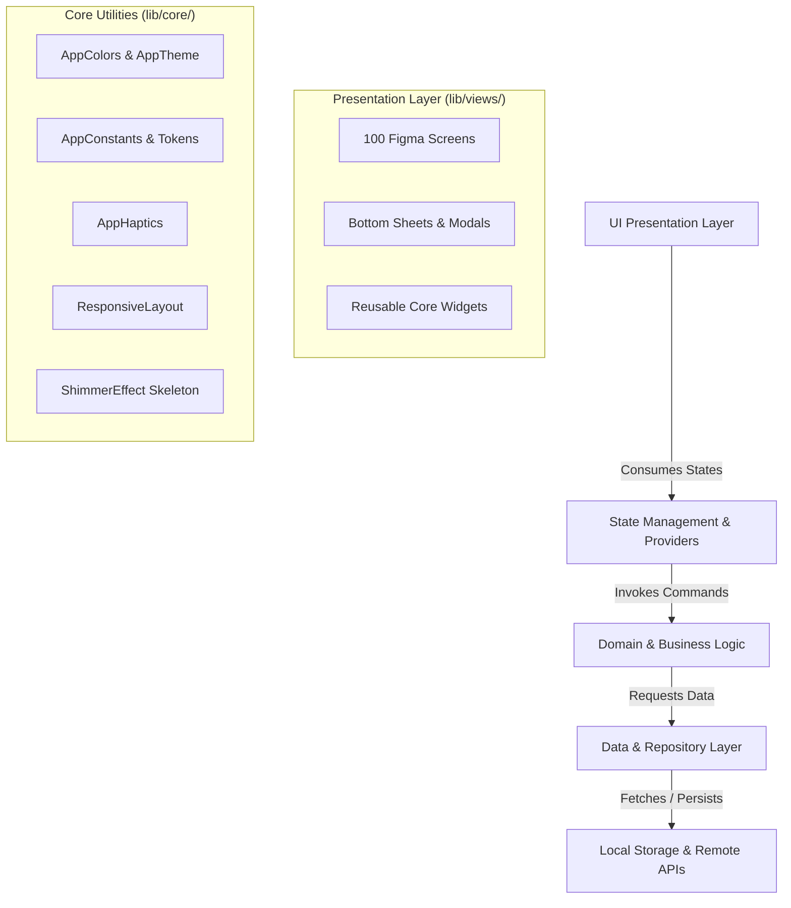

<div align="center">

# 🛍️ Rozio — Enterprise Shoppable Video & Hyperlocal Marketplace

**Next-Generation Shoppable Video Feed, B2B Factory-Direct Wholesale, and 30-Minute Hyperlocal E-Commerce Engine.**

[](https://flutter.dev)
[](https://dart.dev)
[](https://flutter.dev)
[](#-architecture--design-system)
[](#-complete-100-screen-catalog-index)
[](LICENSE)

---

</div>

## 📌 Executive Summary

**Rozio** is a flagship mobile application engineered in Flutter, bridging the gap between high-engagement shoppable media (TikTok/Instagram Reels style) and high-velocity commerce. It uniquely unifies:
1. **Hyperlocal Quick Commerce**: Real-time delivery within **30 minutes**, location geofencing, and live GPS delivery tracking.
2. **Shoppable Video & Live Streaming**: Infinite vertical video feed, real-time live comments, merchant tags, and seamless in-video 1-tap checkout drawers.
3. **B2B Wholesale & Factory Direct**: Bulk purchase tiers, volume savings calculators, and automated GST input-credit invoicing for retailers.
4. **AI-Powered Discovery**: Multi-modal search featuring Text Auto-Complete, Voice Search, Camera/Photo Search, and Conversational Rozio AI.

Built pixel-for-pixel from the master Figma design specification ([Figma Source](https://www.figma.com/design/lXRH6QzGf9IWxyfZK0i7OZ/For-Dev?node-id=0-1)), featuring **100 screens and modal states**.

---

## 🌟 Key Capabilities & Features

### 🎬 Shoppable Video & Live Stream Commerce
- **Vertical Fullscreen Reel Player**: Smooth infinite vertical scrolling video experience with store identity, follow buttons, dynamic audio tags, and animated like/save counters.
- **Shop This Video Drawer**: Non-disruptive bottom drawer allowing users to customize variants (color, edition, quantity) and add to cart without exiting the video stream.
- **Live Stream Shopping Mode**: Live broadcast badge, viewer count indicator, interactive real-time comment stream, and pinned live-deal cards.
- **Store-Specific Reels**: Deep link into any merchant's dedicated video showcase.

### ⚡ Hyperlocal Quick Commerce & Fulfillment
- **Pincode Geo-Fencing**: Instant serviceability check across pincodes with smart fallback location prompts.
- **Express 30-Minute SLA**: Dedicated badge indicators, countdown timers, and priority fulfillment routing.
- **Real-Time GPS Order Tracking**: Live interactive route map displaying warehouse origin, rider GPS location marker, customer drop pin, and dynamic ETA updates.

### 🏢 B2B Wholesale & Enterprise Commerce
- **Tiered Volume Pricing**: Dynamic price drops for bulk purchases (e.g. 1-9 pcs: ₹4,999; 10-49 pcs: ₹4,299; 50+ pcs: ₹3,799).
- **GST Tax Invoicing**: Dedicated B2B checkout module capturing Business Legal Name, GSTIN number, and issuing compliant tax invoices for input-tax credits.
- **Merchant Direct Messaging**: In-app negotiation and inquiry channel connecting wholesale buyers directly with factory store managers.

### 🔍 Next-Gen Multi-Modal Search & AI Assistant
- **Rozio AI Assistant**: Conversational product advisor answering natural queries (e.g. *"Show me ANC earbuds under ₹5000 with 30hr battery"*).
- **Visual / Photo Search**: Camera viewfinder with boundary guides and gallery import matching visual attributes against catalog items.
- **Voice Search**: Real-time speech-to-text waveform UI for hands-free shopping.
- **Comprehensive Filter Suite**: Filter by Price Slider, Customer Rating, Express Delivery, Discount, Brand, and Seller verification.

### 💳 Enterprise Multi-Gateway Checkout
- **Unified Payments (UPI)**: One-tap checkout via Google Pay, PhonePe, Paytm, and custom UPI VPA ID.
- **Card Payments & Auto-EMI**: Credit/Debit cards with bank offer banners and instant EMI installment schedule calculations.
- **Net Banking & Digital Wallets**: Major banks and instant Rozio Wallet balances.
- **Order Celebration**: Full confetti animation, downloadable invoice, and 1-tap live tracking redirect.

---

## 🏗️ Architecture & Design System

Rozio follows a strict **Clean Architecture** pattern, ensuring high maintainability, testability, and separation of concerns.



### 📱 Responsive Layout Adaptation
The app includes a built-in `ResponsiveLayout` engine:
- **Mobile Viewport (width ≤ 480px)**: 100% full-screen native presentation with safe-area padding.
- **Desktop / Web / Tablet (width > 480px)**: Centered mobile flagship device mockup with soft ambient shadows, preventing distorted widescreen stretching during web demos.

---

## 🗂️ Complete 100-Screen Catalog Index

Every single artboard from the master Figma design specification is implemented and directly accessible via the built-in **Figma Screen Catalog** (`/catalog`):

| Artboard ID | Screen Name | Category | Primary Function |
|:---|:---|:---|:---|
| **00** | Brand Splash Screen | Onboarding | Minimalist white splash, Rozio logo, animated loader |
| **S1** | Discover Walkthrough | Onboarding | Carousel slide 1: "Your next great find starts here." |
| **S2** | Wholesale Walkthrough | Onboarding | Carousel slide 2: "Buy stock for your shop at factory prices." |
| **S3** | Fast Delivery Walkthrough | Onboarding | Carousel slide 3: "Daily needs at your door in 30 minutes." |
| **A02** | Language Selection | Onboarding | 8 Indian languages (English, Hindi, Bengali, Marathi, etc.) |
| **A03** | Location Permission | Onboarding | Native GPS permission prompt with security assurances |
| **A04** | Location Found | Onboarding | Detected address confirmation with change option |
| **A05** | Manual Pincode Entry | Onboarding | 6-digit postal code input with instant validation |
| **A06** | Unserviceable Location | Onboarding | Friendly out-of-coverage prompt with notification signup |
| **A07** | Location Switcher Sheet | Onboarding | Saved addresses modal switcher with fast selection |
| **A08** | Mobile Login Sheet | Authentication | Bottom sheet phone number login with OTP trigger |
| **A09** | OTP Verification | Authentication | 4-digit auto-advancing OTP with countdown resend |
| **A10** | OTP Locked State | Authentication | Security lockout with recovery instructions |
| **A11** | Account Recovery (Email) | Authentication | Alternate email verification flow |
| **A12** | Account Recovery (Phone) | Authentication | Primary phone update with dual verification |
| **A13** | Name & Profile Setup | Authentication | First & last name onboarding for new accounts |
| **A14** | Referral Code Input | Authentication | Welcome reward voucher redemption |
| **A15** | Welcome Celebration | Authentication | Animated onboarding completion confirmation |
| **01** | Mega Home Feed | Home & Feed | 4,638px comprehensive discovery feed |
| **02** | Home Location Switcher | Home & Feed | Fast address switching bar |
| **03** | Search Autocomplete | Search | Instant search suggestions & recent history |
| **04** | Voice Search Sheet | Search | Real-time speech-to-text waveform listener |
| **05** | Camera Search Viewfinder | Search | Visual scanner with target box overlays |
| **06** | Photo Search Results | Search | Visual matching catalog matches |
| **07** | Rozio AI Assistant | Search | Natural language AI product discovery chat |
| **08** | Search Results Grid | Search | Filterable product grid with stock badges |
| **09** | Search Filter Sheet | Search | Multi-facet filtering modal |
| **10** | Sort Bottom Sheet | Search | Popularity, price low-to-high, rating sorting |
| **11** | Zero Search Results | Search | Helpful recommendations when no items match |
| **15** | Category Hierarchy | Discovery | Multi-level category browsing tree |
| **16** | Flash Deals Hub | Deals | Limited-time deals with live countdown timers |
| **17** | Clearance Sale | Deals | Deep liquidation discounts and clearance filters |
| **18** | First Order Exclusives | Deals | Special discounts for newly registered accounts |
| **19** | Featured Products Grid | Discovery | Handpicked trending products |
| **20** | Top Stores Directory | Stores | Verified merchants sorted by customer rating |
| **21** | Brand Directory | Brands | A-Z brand catalog with official store links |
| **22** | Brand Showcase Profile | Brands | Brand landing page with hero banner & catalog |
| **23** | Notifications Center | Activity | Order updates, promo alerts, and system notices |
| **24** | Shoppable Reels (For You) | Reels & Video | Infinite vertical shoppable video feed |
| **25** | Reels (Following Tab) | Reels & Video | Video feed restricted to followed merchant stores |
| **26** | Reels Live Streaming | Reels & Video | Live shopping with real-time viewer chat |
| **27** | Shop This Video Drawer | Reels & Video | In-video product sheet with color/edition selectors |
| **28** | Reel Comments Sheet | Reels & Video | Social community comments modal |
| **29** | Empty Following State | Reels & Video | Suggested creators when following list is empty |
| **30** | Video Paused Overlay | Reels & Video | Pause state with video creator credits |
| **31** | Product Details (PDP) | Product | Comprehensive PDP with gallery, pricing & specs |
| **32** | Fullscreen Gallery | Product | Pinch-to-zoom high-res product photo viewer |
| **33** | Wholesale Tier Sheet | Product | B2B volume pricing calculator sheet |
| **34** | Size & Fit Guide | Product | Garment & footwear sizing measurement charts |
| **35** | Customer Ratings & Reviews | Product | Star distribution, photo reviews, verified tags |
| **36** | Questions & Answers (Q&A) | Product | Community and seller answers to buyer questions |
| **37** | Product Compare Sheet | Product | Side-by-side spec comparison against alternatives |
| **38** | Product Offers Sheet | Product | Bank discounts, coupons, and cashback list |
| **39** | Delivery Location Sheet | Product | Instant delivery estimate checker on PDP |
| **40** | Quick Variant Sheet | Product | Rapid color/size switcher from listing cards |
| **41** | Inline Login Bottom Sheet | Product | Non-blocking login prompt when adding to wishlist |
| **42** | Inline OTP Sheet | Product | Inline verification preserving user browsing context |
| **43** | Added to Bag Drawer | Cart & Bag | Instant confirmation drawer with upsell items |
| **44** | Multi-Seller Cart | Cart & Bag | Bag grouped by seller with item quantity steppers |
| **45** | Empty Cart State | Cart & Bag | Clean illustration with trending recommendations |
| **46** | Saved for Later Sheet | Cart & Bag | Wishlist items bookmarked for future purchases |
| **47** | Checkout: Address Step | Checkout | Select delivery address with default indicator |
| **48** | Add New Address Form | Checkout | Geocoded street, landmark, pincode, contact form |
| **49** | Checkout: Order Summary | Checkout | Itemized prices, delivery charges, total savings |
| **50** | B2B GST Invoice Form | Checkout | Enterprise GSTIN and Company Name input |
| **51** | Coupon Drawer | Checkout | Promo code validation with instant discount badge |
| **52** | Checkout: Payment Options | Checkout | UPI, Cards, Net Banking, EMI, Cash on Delivery |
| **53** | Card Payment Form | Checkout | 16-digit card input with auto-detecting bank logo |
| **54** | EMI Calculator Sheet | Checkout | 3, 6, 9, 12 month installment plans with interest |
| **55** | Net Banking Selector | Checkout | Popular bank grid and search filter |
| **56** | Rozio Gift Card & Wallet | Checkout | Gift voucher redemption and balance deduction |
| **57** | Payment Processing | Checkout | Secure 3D-Secure bank gateway mock simulation |
| **58** | Payment Failed Recovery | Checkout | Error diagnostics and alternate payment selector |
| **59** | Order Placed Celebration | Checkout | Confetti animation, order ID, delivery estimate |
| **60** | Orders List Screen | Orders | Active and past orders with status chips |
| **61** | Order Tracking Timeline | Orders | Multi-stage status stepper (Placed → Packed → Dispatched → Delivered) |
| **62** | Live GPS Delivery Map | Orders | Real-time map with rider icon and ETA countdown |
| **63** | Order Help & Issues | Orders | Self-service issue resolution menu |
| **64** | Customer Support Chat | Orders | Interactive support conversation with Rozio agent |
| **65** | Cancel Order Flow | Orders | Cancellation reason selection and refund preview |
| **66** | Cancellation Confirmed | Orders | Refund destination confirmation screen |
| **67** | Rate & Review Purchase | Orders | 5-star rating, photo upload, and text review |
| **68** | Return & Replace Wizard | Orders | Defect photo upload and replacement scheduler |
| **69** | Return Request Timeline | Orders | Pickup driver status and refund timeline |
| **70** | Store Profile Screen | Store | Merchant banner, badges, rating, catalog tabs |
| **71** | Store Products Tab | Store | Complete merchant catalog with in-store search |
| **72** | Store Reels Showcase | Store | Merchant's shoppable videos in a dedicated grid |
| **73** | Merchant Direct Chat | Store | Direct messaging with merchant customer desk |
| **CATALOG** | Figma Screen Catalog | Developer | Interactive 100-screen browser with instant search |

---

## 💻 Tech Stack & Packages

- **Framework**: [Flutter 3.x](https://flutter.dev) (Channel stable)
- **Language**: [Dart 3.x](https://dart.dev) (Sound null-safety)
- **State Management**: [`provider`](https://pub.dev/packages/provider) (Separation of concerns with reactive update listeners)
- **Typography & Theme**: [`google_fonts`](https://pub.dev/packages/google_fonts) (Inter typography across all screen tiers)
- **Network & Caching**: [`cached_network_image`](https://pub.dev/packages/cached_network_image) (Optimized multi-resolution image caching)
- **Local Persistence**: [`shared_preferences`](https://pub.dev/packages/shared_preferences) (Pincode, language, session caching)
- **Internationalization**: [`intl`](https://pub.dev/packages/intl) (Date formatting, currency parsing)
- **Icons**: [`cupertino_icons`](https://pub.dev/packages/cupertino_icons) & Material Design 3 symbols

---

## 🚀 Getting Started

### Prerequisites
- [Flutter SDK](https://docs.flutter.dev/get-started/install) (`^3.13.4` or later)
- Android Studio / Xcode / VS Code with Flutter extensions
- Chrome (for web testing)

### Installation & Run

1. **Clone the repository**:
   ```bash
   git clone https://github.com/Diploy-Space/Drozio.git
   cd Drozio
   ```

2. **Fetch all dependencies**:
   ```bash
   flutter pub get
   ```

3. **Verify static analysis** (0 warnings, 0 errors guaranteed):
   ```bash
   flutter analyze
   ```

4. **Execute the automated test suite**:
   ```bash
   flutter test
   ```

5. **Run the application**:
   - On Chrome / Web:
     ```bash
     flutter run -d chrome
     ```
   - On iOS Simulator / macOS:
     ```bash
     flutter run -d macos
     # or
     flutter run -d ios
     ```
   - On Android:
     ```bash
     flutter run -d android
     ```

---

## 🧪 Testing & Quality Assurance

The codebase enforces strict code quality through comprehensive automated test suites:
- **Unit Tests**: Coverage across `CartProvider`, `LocationProvider`, and `ReelProvider`.
- **Widget Smoke Tests**: Initial render validation and splash flow verification.
- **Responsive Tests**: Viewport breakpoint verification across mobile and wide desktop viewports.
- **Static Analysis**: Configured with strict linting rules in `analysis_options.yaml`.

Run all tests with coverage:
```bash
flutter test --coverage
```

---

## 📂 Project Structure

```
Rozio/
├── .github/
│   └── workflows/
│       └── flutter_ci.yml         # GitHub Actions CI pipeline
├── lib/
│   ├── core/                      # Application core module
│   │   ├── constants/             # Design tokens, SLAs, app metadata
│   │   ├── routes/                # Named route definitions & router
│   │   ├── theme/                 # AppColors & AppTheme definitions
│   │   ├── utils/                 # AppHaptics micro-interaction utility
│   │   └── widgets/               # ShimmerLoading, ResponsiveLayout, CustomButton, ErrorBoundary
│   ├── data/
│   │   └── models/                # Typed data models (Product, CartItem, Reel, Language)
│   ├── providers/                 # State management (CartProvider, LocationProvider, ReelProvider)
│   ├── views/                     # 100 Figma UI screens & sheets
│   │   ├── auth/                  # Login, OTP, Account Recovery
│   │   ├── brands/                # Brands directory & detail
│   │   ├── cart/                  # Multi-seller cart & added to bag drawer
│   │   ├── catalog/               # FigmaScreenCatalogScreen (100 screens)
│   │   ├── checkout/              # 13 checkout, payment & celebration screens
│   │   ├── deals/                 # Flash deals, clearance, first-order exclusives
│   │   ├── home/                  # Mega home feed & location bar
│   │   ├── notifications/         # Notification center
│   │   ├── onboarding/            # Splash, S1-S3 walkthrough, language, location
│   │   ├── orders/                # Orders list, tracking, live GPS map, support chat
│   │   ├── product/               # PDP, reviews, Q&A, size guide, wholesale sheet
│   │   ├── reels/                 # Vertical shoppable reels & live streaming
│   │   ├── search/                # AI assistant, photo search, voice search, filters
│   │   └── store/                 # Store profile, reels, products, direct chat
│   └── main.dart                  # Application entry point with ResponsiveLayout
├── test/                          # Unit and widget test suite
├── analysis_options.yaml          # Strict enterprise lint rules
└── pubspec.yaml                   # Package dependencies and metadata
```

---

## 📄 License & Attribution

Designed and engineered for **Rozio E-Commerce Technologies**.  
Repository: [https://github.com/Diploy-Space/Drozio.git](https://github.com/Diploy-Space/Drozio.git)
